<div align="center">

# SAQAI · سَقاي

### Intelligence behind every drop · كل قطرة بقرار

A smart multi-zone irrigation system that measures soil and weather on site, predicts rain three hours ahead with a machine-learning model, decides **on the device** which zone needs water, and stops everything within seconds when rain actually falls.


[العربية](README.ar.md) · [Architecture](#architecture) · [AI model](#the-ai-model) · [Getting started](#getting-started) · [Docs](#documentation)

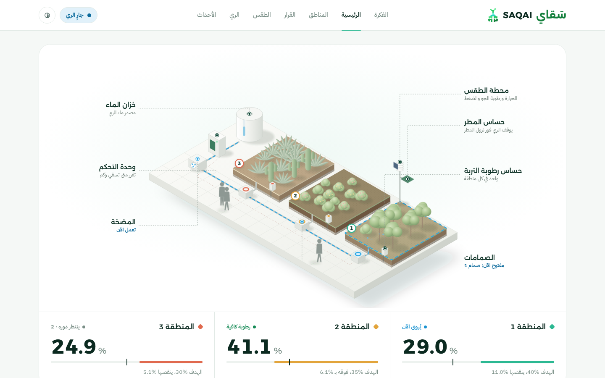

</div>

---

## Table of contents

- [The problem](#the-problem)
- [What SAQAI does](#what-saqai-does)
- [The prototype](#the-prototype)
- [Architecture](#architecture)
- [How a watering decision is made](#how-a-watering-decision-is-made)
- [When rain starts](#when-rain-starts)
- [The AI model](#the-ai-model)
- [Safety by design](#safety-by-design)
- [Dashboard](#dashboard)
- [Hardware](#hardware)
- [Getting started](#getting-started)
- [Configuration](#configuration)
- [API](#api)
- [Testing](#testing)
- [Repository structure](#repository-structure)
- [Documentation](#documentation)
- [Team](#team)
- [Acknowledgments](#acknowledgments)

## The problem

Most irrigation runs on a timer. It waters soil that is already wet, and it waters an hour before the rain. In a city like Riyadh, where every litre counts, that is water poured away twice.

## What SAQAI does

| | |
|---|---|
| **Measures** | Soil moisture in each of 3 zones, plus temperature, humidity, pressure and rain on the plate, every 2 seconds. |
| **Predicts** | The chance of rain in the next 3 hours, from the station's own readings, every 30 minutes. |
| **Decides** | On the actuator board itself: 8 questions per zone, then waters the thirstiest zone (one pump, one valve at a time). |
| **Protects** | Rain on the sensor stops the pump within seconds, whatever the model said. |
| **Explains** | Every decision is stored with its reason and shown step by step on a live dashboard. |

All runtime data comes from real sensors. Historical weather data is used for training only.

## The prototype

<p align="center">
  
</p>

The real system we built: a weather station mast (BME280 and rain plate) over three soil zones, each with its own moisture probe, fed by one pump through three irrigation valves, with the electronics in a clear enclosure.

## Architecture

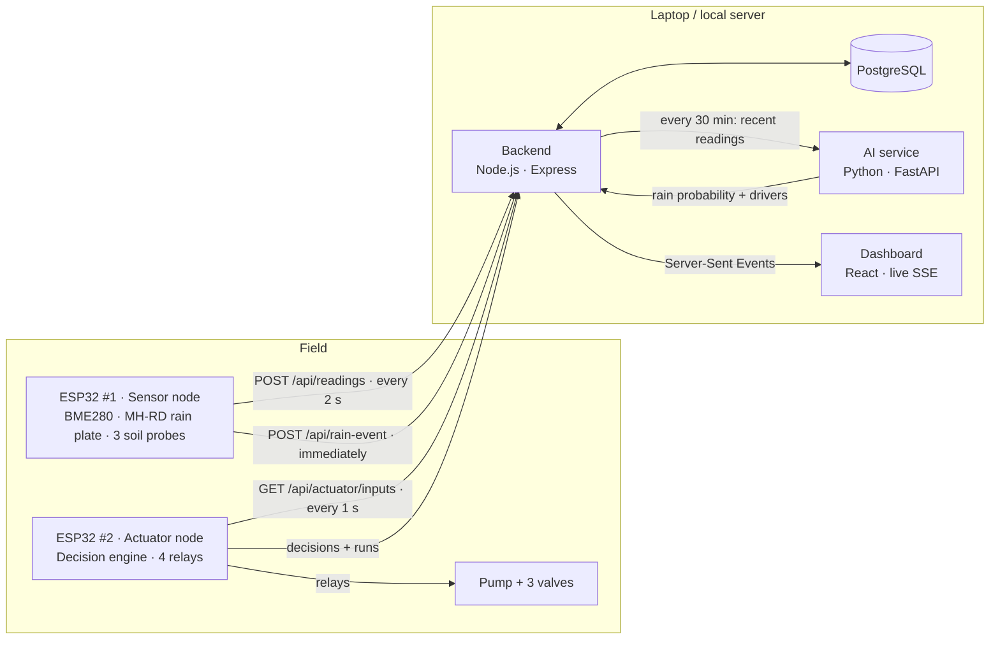

The two boards never talk to each other directly. Everything passes through the backend, which also owns the rain lockout and the log. All devices sit on the same local network (a phone hotspot is enough), and nothing needs the internet at runtime.

## How a watering decision is made

ESP32 #2 polls the backend every second and runs `saqai_decision.h` for every zone. The first rule that blocks watering ends the decision, and every step is recorded in a trace that the dashboard shows.

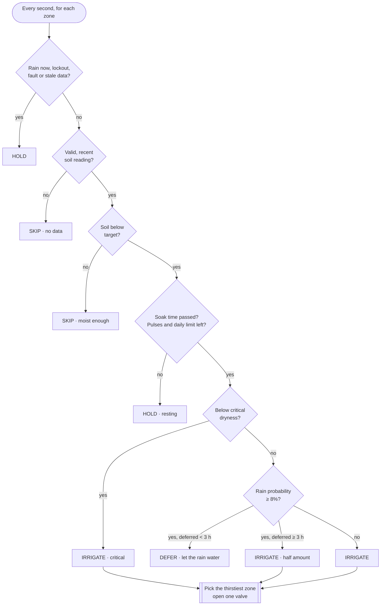

Watering happens in short pulses: water, wait for it to soak in, read the sensor again, and stop as soon as moisture reaches target + 2 %. The same engine is unit-tested on a laptop (35 tests).

## When rain starts

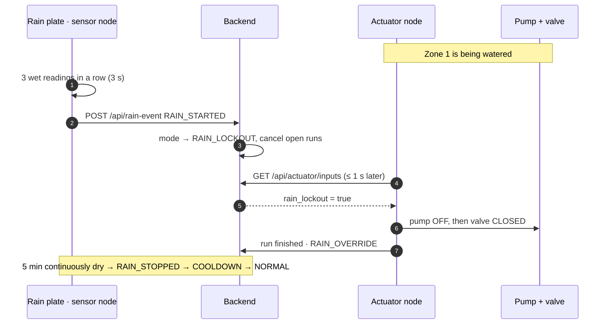

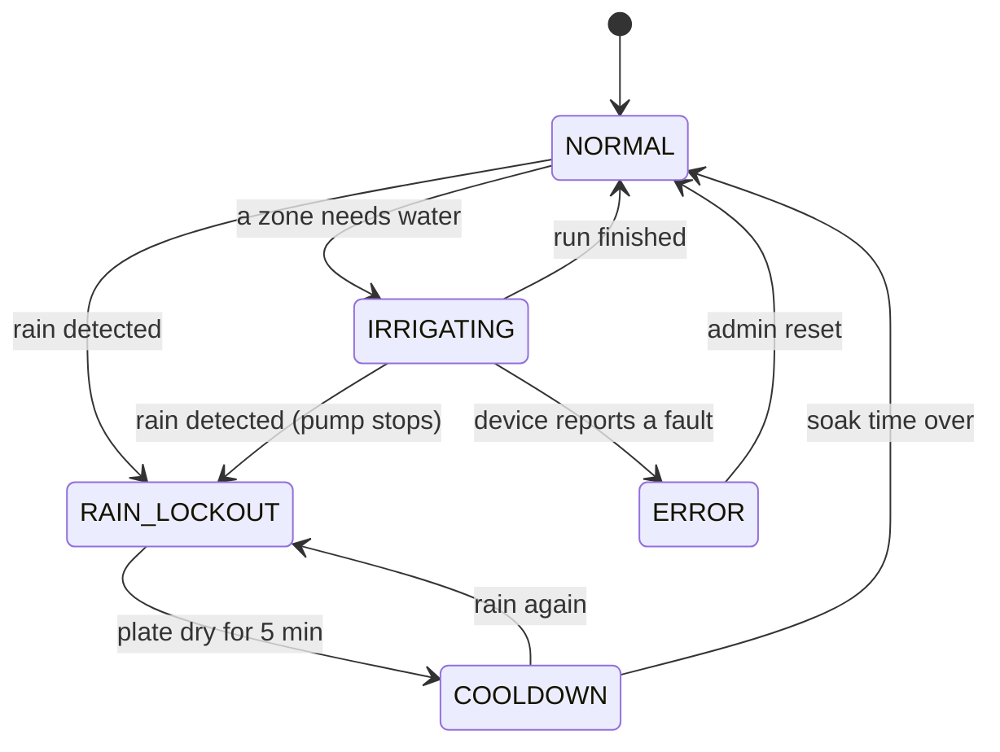

## The AI model

The model answers one question: **"It is dry now. Will it rain in any of the next 3 hours?"** It can only *postpone* watering. It never opens a valve and never overrides safety.

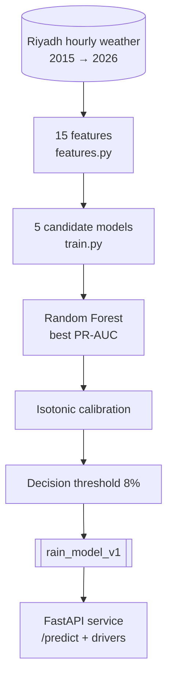

**Data and split.** Hourly temperature, humidity, pressure and rainfall for Riyadh. An hour counts as rainy at ≥ 0.1 mm, which is only **1.7 %** of hours. The split is by time, never shuffled, so the test years are truly unseen:

| Period | Used for |
|---|---|
| 2015 → 2022 | Training |
| 2023 | Probability calibration |
| Jan → Jun 2024 | Model selection and threshold |
| Jul 2024 → 2026 | Final test (never seen) |

**Features.** All 15 come from the station alone, and `features.py` is shared by training and serving so they always mean the same thing: current temperature, humidity and pressure; dew point and dew-point depression; their change over 1 h and 3 h; hour of day and season as cyclic (sin/cos) values.

**Model selection** (validation PR-AUC, higher is better):

| Model | PR-AUC |
|---|---|
| **Random Forest** (300 trees) | **0.197** |
| XGBoost | 0.196 |
| LightGBM | 0.171 |
| Logistic Regression | 0.148 |
| Decision Tree | 0.116 |

**Results on the unseen test period:**

| Metric | Value | In plain words |
|---|---|---|
| ROC-AUC | 0.929 | Separates rainy from dry hours well |
| PR-AUC | 0.172 | About 10× better than chance (1.7 %) |
| Rain onsets warned 3 h ahead | 62 % | 48 of 77 times rain started |
| Threshold | 8 % | Chosen by the cost of errors, see below |

**Why 8 %.** The two mistakes do not cost the same. A false "rain is coming" delays watering by at most 3 hours, and critical dryness is never deferred. A missed rain wastes the water. So the threshold sits below the F1-optimal 10.7 %: same precision, more rain caught. A hysteresis of 3 points stops the decision flickering around the threshold.

**What drives it.** Dew point, season and humidity matter most. Pressure and its trend are supporting signals. Each prediction comes with its top drivers ("what moved the forecast"), computed by resetting each reading to its typical value.

**Honest limits.** The model misses part of the rain, and its high probabilities are over-confident (a predicted ~58 % was ~34 % in testing). That is exactly why the rain sensor, not the model, owns safety. The full report is in [`ai/reports/rain_model_v1.md`](ai/reports/rain_model_v1.md).

## Safety by design

| Situation | What happens |
|---|---|
| Rain while watering | Pump off within ~3–5 s, system enters rain lockout |
| Wi-Fi or backend lost | ESP32 #2 stops the pump after 3 failed polls (~3 s) |
| Sensor node silent > 10 s | No watering on stale data |
| Pump runs too long | Hard 60 s limit on the board itself, whatever the backend sends |
| ESP32 #2 loses power | Relays wired on **NO** contacts, so everything switches off |
| Rain-plate signal wire breaks | With the recommended 100 kΩ pull-down it reads as "wet", so watering stops |
| Model wrongly predicts rain | Deferral capped at 3 h, critical dryness always watered |
| Model misses rain | The rain sensor stops everything |

On every run the pump turns off **before** the valve closes, and the valve opens 300 ms **before** the pump. The backend can refuse a run before any water flows.

## Dashboard

An Arabic, right-to-left interface, live over Server-Sent Events, with light and dark themes and a phone layout.

| Page | What it shows |
|---|---|
| **The idea** (الفكرة) | Scroll story for visitors: soil → weather → forecast → decision → rain |
| **Home** (الرئيسية) | Live isometric farm model, zone cards, pump, weather, rain forecast, latest events |
| **Zones** (المناطق) | One zone in detail with a 24-hour moisture chart and its runs |
| **Decision** (القرار) | Which zone gets water first, and why each zone was watered, deferred, skipped or held ([how to read it](#reading-the-decision-page)) |
| **Weather** (الطقس) | Current readings, rain probability gauge, forecast drivers, model card |
| **Runs** (الري) | Every pump run: duration, estimated litres, result |
| **Events** (الأحداث) | Rain, lockouts, device connections, newest first |

<table>
  <tr>
    <td>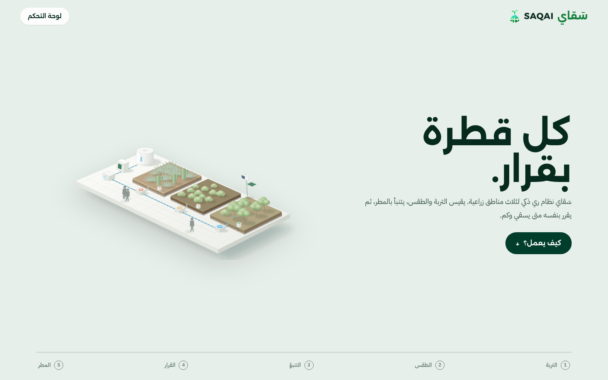</td>
    <td>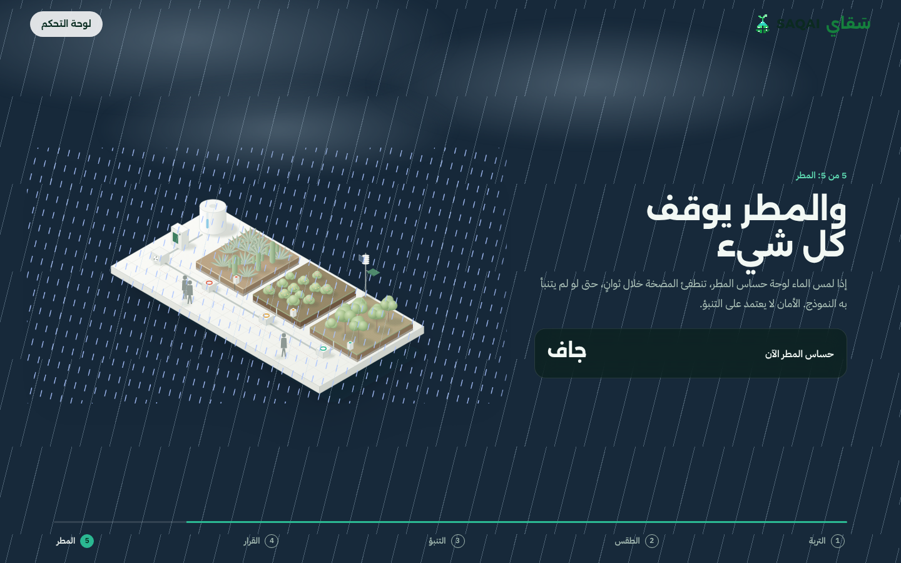</td>
  </tr>
  <tr>
    <td>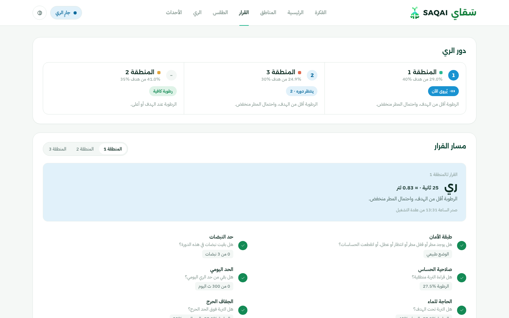</td>
    <td>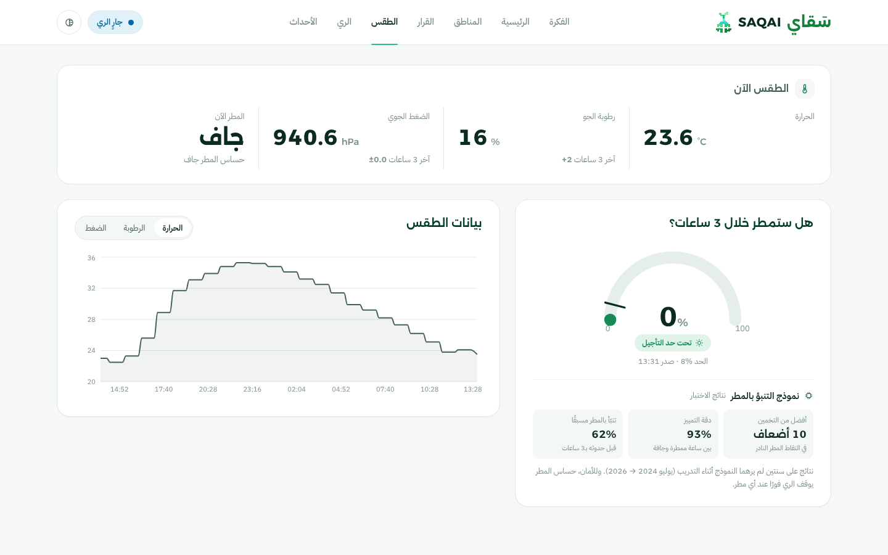</td>
  </tr>
  <tr>
    <td>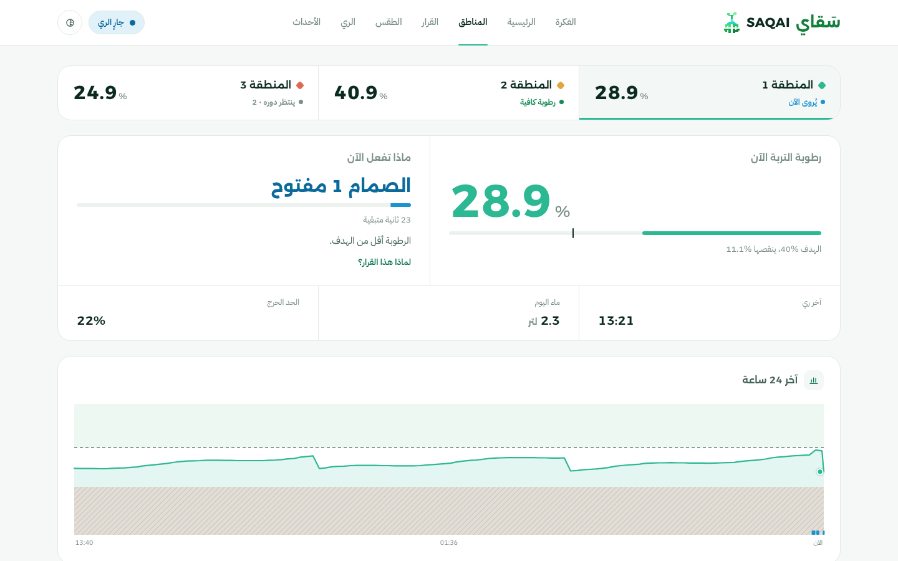</td>
    <td>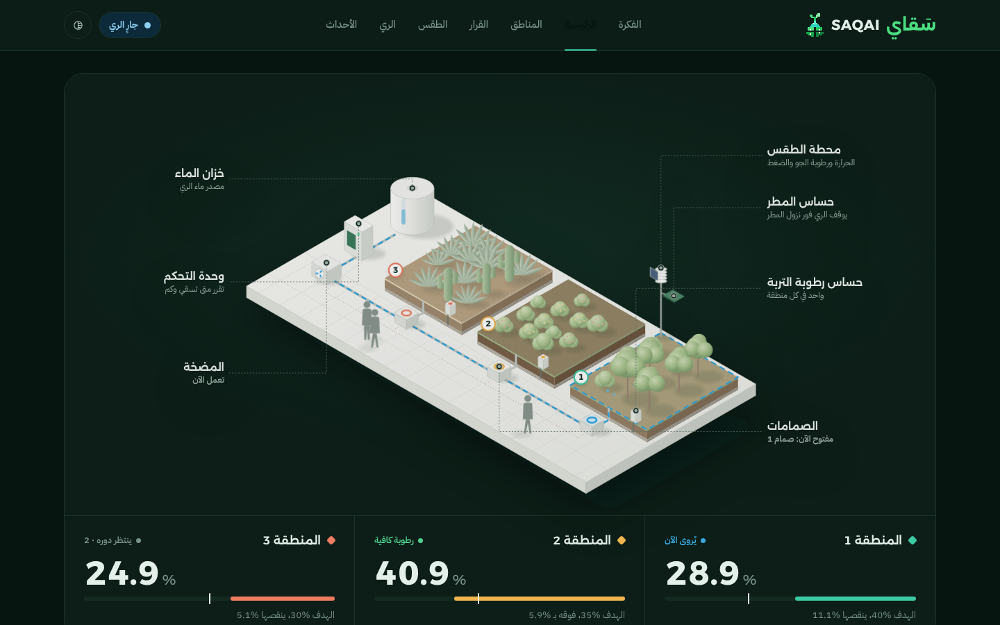</td>
  </tr>
</table>

<sub>Screenshots use recorded data from the prototype.</sub>

### Reading the Decision page

The page answers two questions: **who is watered first**, and **why**.

**1. Watering queue.** One pump can feed only one zone at a time, so the zones that need water are ranked by how far they are below their own target:

```
urgency = (target − moisture) ÷ target
```

A zone below its *critical* level always ranks first (urgency 1 + deficit). Ties go to the lower zone number.

| Zone | Moisture | Target | Urgency | Queue |
|---|---|---|---|---|
| Zone 1 | 29 % | 40 % | 0.28 | **1** · being watered |
| Zone 3 | 25 % | 30 % | 0.17 | **2** · waits its turn |
| Zone 2 | 41 % | 35 % | — | – · moist enough |

When zone 1's pulse ends, it soaks for 2 minutes and is measured again, and zone 3 gets the pump in the meantime.

**2. Decision path.** Pick a zone to see the 8 questions ESP32 #2 asked it, in order. Passed steps show ✓ with the reading that passed (for example `29.0% vs target 40%`). The first step that blocks watering is highlighted with its reason, and the steps after it are not asked.

| # | Step | Question | If it blocks |
|---|---|---|---|
| 1 | Safety | Any rain, lockout, fault or stale data? | **Hold**: no water at all |
| 2 | Sensor | Is the soil reading present and valid? | **Skip**: never water on a bad number |
| 3 | Need | Is the soil below its target? | **Skip**: moist enough |
| 4 | Soak | Have 2 minutes passed since the last pulse? | **Hold**: let the water reach the probe |
| 5 | Pulses | Fewer than 3 pulses without reaching target? | **Hold** 30 min: probe may be misplaced |
| 6 | Daily | Under 5 minutes of watering today? | **Hold** until tomorrow |
| 7 | Critical | Is the soil below its critical level? | **Water now**, even if rain is forecast |
| 8 | Forecast | Is the rain probability below 8 %? | **Defer** up to 3 h, then water half |

At the top, the verdict card shows the result: **Irrigate** (with seconds and estimated litres), **Defer**, **Skip** or **Hold**, and the reason in one line.

**How long it waters:** `(target − moisture) × seconds per 1 %` for that zone, +15 % above 40 °C, −10 % when the air is above 60 % humidity, between 3 and 60 seconds (follow-up pulses at most 10 s). Litres are an estimate: `seconds × pump flow ÷ 60`.

## Hardware

**ESP32 #1 · sensor node**

| Part | Pin |
|---|---|
| BME280 (temperature, humidity, pressure) | SDA → GPIO21 · SCL → GPIO22 · 3V3 |
| MH-RD rain plate module | AO → GPIO36 · DO → GPIO27 · VCC → **3V3** · 100 kΩ AO→GND |
| Capacitive soil probes, zones 1–3 | GPIO32 · GPIO33 · GPIO34 (ADC1 only, works with Wi-Fi) |

**ESP32 #2 · actuator node**

| Relay | Pin |
|---|---|
| IN1 → pump | GPIO22 |
| IN2 / IN3 / IN4 → valves 1 / 2 / 3 | GPIO21 / GPIO19 / GPIO4 |

Pump and valves are switched through relays on NO contacts, with a fuse and a flyback diode on each coil. Wiring, power and protection: [`docs/hardware.md`](docs/hardware.md).

## Getting started

**You need:** Docker Desktop, Node.js 20+, Python 3.12, Arduino IDE 2, and a 2.4 GHz Wi-Fi network (a phone hotspot works).

```bash
# 1. Configuration (then edit DEVICE_API_KEY in backend/.env)
cp .env.example .env
cp .env.example backend/.env

# 2. Dependencies
python3 -m venv .venv
.venv/bin/pip install -r ai/requirements.txt
(cd backend && npm install)
(cd frontend && npm install && npm run build)

# 3. Run database + AI service + backend + dashboard
./start.sh            # Windows: double-click start.bat
```

The backend prints the address to use, for example `http://172.20.10.3:3000`. Open it in a browser for the dashboard, and put the same address in `BACKEND_URL` on both boards.

**Flash the boards** (Arduino IDE → board **ESP32 Dev Module**, libraries **Adafruit BME280** and **ArduinoJson 7**):

1. In `esp32/sensor_node/` and `esp32/actuator_node/`, copy `secrets.example.h` to `secrets.h`.
2. Fill in the Wi-Fi name and password, `BACKEND_URL`, and the same `DEVICE_API_KEY` as `backend/.env`.
3. Upload. In the Serial Monitor (115200), the sensor node should print `HTTP 201`.

Then run `cd backend && npm run doctor` for a full system check. Step-by-step bring-up with troubleshooting: [`docs/bring-up.md`](docs/bring-up.md). Sensor calibration: [`docs/calibration.md`](docs/calibration.md).

> The model needs 3 hours of station readings before its first forecast. Until then the boards water by soil moisture alone.

## Configuration

Main settings in `backend/.env`. They are sent to ESP32 #2 on every poll, so no reflashing is needed.

| Variable | Default | Meaning |
|---|---|---|
| `DEVICE_API_KEY` | — | Shared key both boards send in `x-api-key` |
| `ADMIN_API_KEY` | = device key | Key for the hidden maintenance page |
| `PUMP_FLOW_LPM` | 2.0 | Measured pump flow, used for litre estimates |
| `RAIN_COOLDOWN_MINUTES` | 5 | Wait after rain stops before deciding again |
| `MAX_DEFER_HOURS` | 3 | Longest deferral for forecast rain |
| `DEFER_HYSTERESIS` | 0.03 | Deferral ends below threshold − 0.03 |
| `SOAK_SECONDS` | 120 | Wait after a pulse for water to reach the probe |
| `DAILY_MAX_SECONDS_PER_ZONE` | 300 | Daily watering cap per zone |
| `MAX_PUMP_ON_SECONDS` | 60 | Per-run cap (the board's own 60 s limit always wins) |

Zone targets, critical levels and seconds-per-percent are edited live from the maintenance page (`/#/maintenance`).

## API

| Caller | Endpoint | Purpose |
|---|---|---|
| ESP32 #1 | `POST /api/readings` | Sensor frame every 2 s |
| ESP32 #1 | `POST /api/rain-event` | Rain started / stopped, immediately |
| ESP32 #2 | `GET /api/actuator/inputs` | Readings, forecast, zone settings, safety state, every 1 s |
| ESP32 #2 | `POST /api/actuator/decisions` | Decision and trace per zone |
| ESP32 #2 | `POST /api/actuator/run` | Run started / finished (the backend can refuse) |
| Dashboard | `GET /api/status` · `GET /api/history` · `GET /api/stream` | Everything on screen, 24 h history, live events |
| Admin | `PATCH /api/admin/zones/:id` · `POST /api/admin/manual-run` | Calibration and test runs |

Full contract: [`docs/api-contract.md`](docs/api-contract.md).

## Testing

```bash
cd backend
npm run test:firmware   # 35 unit tests for the on-board decision engine (C++)
npm test                # rain-lockout state machine (Jest)
npm run doctor          # live system check
```

The end-to-end safety test (`npm run e2e`, 36 checks with the real C++ engine) must run on a **separate test database**, see [`docs/test-plan.md`](docs/test-plan.md). GitHub Actions runs the firmware tests, the backend tests and the dashboard build on every push.

Retrain the model with `python ai/src/train.py`, then `python ai/scripts/set_threshold.py 0.08`.

## Repository structure

```
saqai/
├── esp32/
│   ├── sensor_node/        ESP32 #1: sensors, frame every 2 s, instant rain events
│   ├── actuator_node/      ESP32 #2: relays + saqai_decision.h (the decision engine)
│   └── tests/              C++ unit tests for the engine
├── backend/                Node.js + Express: ingest, SSE, safety, AI scheduling
├── ai/
│   ├── src/                features, training, calibration, explanations
│   ├── service/            FastAPI prediction service
│   ├── models/             rain_model_v1 (model + card)
│   └── reports/            model report with all metrics
├── frontend/               React dashboard (Vite)
├── database/               schema and seed data
├── data/raw/               Riyadh hourly weather (training only)
├── tools/doctor.js         full system check
├── docs/                   guides (Arabic) and images
├── docker-compose.yml      PostgreSQL (+ Adminer)
└── start.sh · start.bat    one-command start
```

## Documentation

The detailed guides are in Arabic:

| Guide | Contents |
|---|---|
| [`code-guide.md`](docs/code-guide.md) | Map of the code and the path from a reading to a valve |
| [`bring-up.md`](docs/bring-up.md) | Running on real hardware, step by step, with fixes |
| [`hardware.md`](docs/hardware.md) | Wiring, relays, power and protection |
| [`calibration.md`](docs/calibration.md) | Soil probes, rain plate, pump flow |
| [`architecture.md`](docs/architecture.md) | Design decisions |
| [`api-contract.md`](docs/api-contract.md) | Every endpoint and payload |
| [`test-plan.md`](docs/test-plan.md) | How the system is tested |


## Team

Built by the SAQAI team at Tuwaiq Academy x MISK for the Expo 2030 Riyadh challenge.

| Name | Role | LinkedIn |
|---|---|---|
| Saikha Alkhathlan | Team leader | [](MEMBER_1_LINKEDIN) |
| Rana Alsirhani | Team member | [](MEMBER_2_LINKEDIN) |
| Renad Alonzi| Team member | [](MEMBER_3_LINKEDIN) |
| Norah Alsuwailem | Team member | [](MEMBER_4_LINKEDIN) |

## Acknowledgments

**Special thanks to all the instructors at [Tuwaiq Academy](https://tuwaiq.edu.sa)** for their guidance, patience and support throughout the program. This project would not exist without what we learned from them.

We are grateful to:

- **[Misk Foundation](https://misk.org.sa)** and **[Tuwaiq Academy](https://tuwaiq.edu.sa)** for the program and the hackathon that made this project possible.
- **Expo 2030 Riyadh** for the vision that inspired it: sustainable solutions for the cities of tomorrow.

<sub>SAQAI is a student project. It is not an official product of Expo 2030 Riyadh, Misk Foundation or Tuwaiq Academy.</sub>
